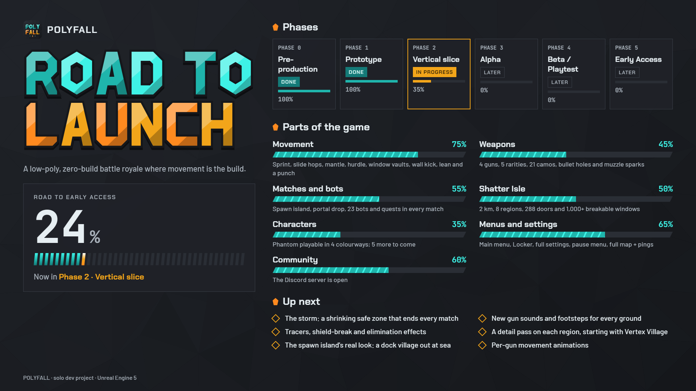

  

# POLYFALL

**A first-person, low-poly battle royale where movement replaces building.**

Drop onto a faceted, brightly coloured island, loot weapons and shields, and outmove everyone else. No building, no edits: positioning, cover and movement skill decide every fight.

**Live roadmap:** https://yasacct.github.io/polyfall-roadmap/

**Discord:** https://discord.gg/rpAQsXXg2n

| | |
| --- | --- |
| **Genre** | Zero-build battle royale, first person |
| **Players** | 24-40 per match, bots fill empty slots |
| **Match length** | About 12-18 minutes |
| **Platform** | PC on Steam first |
| **Runs on** | Mid-range PCs at 60+ FPS, down to a GTX 1650 / Steam Deck on Low |
| **Made by** | A solo developer, Shardwork Games |
| **Engine** | Unreal Engine 5 |

## Design pillars

1. **Movement is the build.** Traversal is the skill ceiling. Every surface invites a slide, a vault or a climb.
2. **Readable at a glance.** Clean low-poly shapes and a strict palette make enemies, loot and cover easy to read.
3. **Short, tense matches.** Smaller lobbies, a fast storm and frequent fights.

## How a match works

1. **Spawn island.** Every match starts on a small island out at sea. Practise your movement, try the guns and pick where you want to drop on the map.
2. **Shard portal.** When the countdown ends, walk through your own portal and step out at your spot on Shatter Isle.
3. **Loot.** Search every building: open dressers, fridges and lockers. Doors can be locked from inside or bashed open, and every window breaks.
4. **Fight.** Rotate ahead of the storm and outplay everyone until one player is left.
5. **Quests.** Three quests in every match (with a fresh set every few minutes) plus daily quests, all for account XP.

## The movement kit

| Move | What it does |
| --- | --- |
| Sprint / tactical sprint | Run faster; a short burst to cross open ground |
| Slide + slide hop | Keep your momentum low to the ground; jump out of a slide and land straight into the next |
| Mantle | Climb ledges up to about 2 m |
| Hurdle | Vault waist-high cover without losing speed |
| Window vault | Jump through a window and the glass shatters |
| Wall kick | One extra jump off a wall |
| Lean | Peek around corners |
| Punch | A quick hit when you're out of options |

Every character moves exactly the same, so a skin is never an advantage.

## Health and shields

- **150 health + 150 shield.** Nothing hidden.
- Shield comes from **Shards** you carry and crush:
  - **Shard** (+25): crushed in one hand, and you can keep shooting.
  - **Core Shard** (+50): crushed with both hands.
- Crushing is loud and visible: a teal burst and a glass crack other players can hear.

## Weapons

- **Playable now:** Facet AR (assault rifle), Breaker (pump shotgun), Hornet SMG and the Sidearm everyone starts with.
- **Coming:** a burst rifle, an auto shotgun, a sniper, a launcher and more weapons and types of weapons.
- **Five rarities**, Common to Legendary, with a small damage step per tier. Rifles and SMGs come with an optic from Epic up.
- **21 weapon camos** plus mastery camos. Looks only.

## Shatter Isle

An island about 2 km across, with a crashed data core in the middle and eight regions around it:

| Region | What it's like |
| --- | --- |
| **Core Crater** | The hot drop around the crashed core |
| **Vertex Village** | A woodsy village, house-to-house fights |
| **Prism Port** | Desert docks with long sightlines |
| **Glitch Mall** | An abandoned mall turned base, multi-floor indoor fights |
| **Overclock Yards** | A work yard of cranes and shipping containers |
| **Frostbyte Lodge** | A ski resort with slopes made for sliding |
| **Static Heights** | Icy mountains with caves and high ground |
| **Uncharted Land** | A dense forest where outcasts hide |

Every building has two or more ways in and a roof you can climb to.

## The story

**The Render** is a simulation built to preserve a dying world. A crash rebuilt it at minimum detail, which is why everything looks low-poly. Its last copies of people, the **Echoes**, fight in the Shatter Isle trials: the winner's data is saved, and everyone else is reset.

| Faction | Who they are |
| --- | --- |
| **The Wardens** | The original security programs, keeping the trials stable |
| **The Fractured** | Echoes corrupted by the crash, trying to break the simulation open |
| **The Drifters** | Mercenary Echoes who just want to win, get saved and get paid |

## Characters

- **Phantom**, a Warden scout with a long hard-light data scarf, is playable in four colourways.
- **Coming:** Byte, Shard, Nomad, Glitch, Rook and more.
- Characters are cosmetic only. Abilities come from the Assist Kit.

## Assist Kit, kept fair

- Everyone brings **one active assist and one passive perk**, for example a short dash or faster mantling.
- No damage, health, shield or accuracy boosts. Long cooldowns, and every ability has a visible tell and a counter.
- Levelling unlocks choices and sidegrades, never more power.

## Modes

- **At launch:** a Solo Battle Royale mode, and **the Range**, a training mode with targets, training bots, drills and a movement course.
- **Later:** Duos and Trios, Zone Wars, a Zombies mode, more PvP modes and a story campaign.

## Our promises

- Built for PC first and tuned to run on modest hardware.
- Community ideas are a priority and consistently kept up with.
- Constant updates, new features, complete overhauls and more.

---

*POLYFALL is a working title and in development: everything here can still change. Percentages on the roadmap are estimates and move with real work.*
